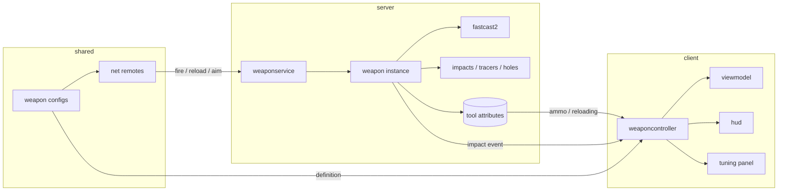
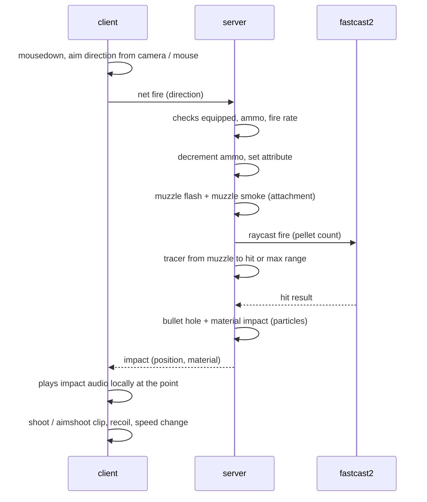

# @devmako | riotes-gun-demo for @Riotes

a gun system demo built for riotes. pure luau, synced with rojo.

server owns the guns (ammo, fire rate, hits). the client owns the feel (view model, ads, recoil, bob, camera).
the two weapons themselves live inside the place under `StarterPack` — this repo is the code that drives them.

## what it does

- server-authoritative hitscan firing through fastcast2
- rifle + shotgun (brick gun) weapon classes with per-gun configs
- first person view model: cloned rig, arms mirrored from the real animations, native grip weld
- third person: body turns to the aim while shooting, camera pulls back properly
- ads with dedicated aim / aim-fire animation clips, fov zoom, spread tightening
- recoil + camera shake + strafe roll + speed-based bob
- movement states: walk / sprint / aiming / firing / aiming+firing
- per-material impact effects (particles + sound) from `ServerStorage.HitEffects`
- muzzle smoke on the gun's own muzzle attachment, tracers with fade, bullet holes
- bottom-right minimalist hud, per-weapon view model tuning panel (`f2`)

## structure

```
default.project.json        rojo mapping
src/
  client/
    Main.client.luau         bootstrap
    GunSystem/
      WeaponController.luau  input, camera, view model, hud, animations
      ViewModel.luau         first person rig (clone + mirror + native tool)
      Tuning.luau            f2 panel, per-gun profiles
  server/
    Main.server.luau         bootstrap
    GunSystem/
      WeaponService.luau     remotes, tool setup, sfx, hit sounds publish
      Weapon.luau            per-instance weapon: fire, reload, ammo, effects
  shared/
    GunSystem/
      Net.luau               remotes (fire, reload, hit, aim, debug, impact)
      WeaponConfig.luau      config resolution: gun > type > defaults
      WeaponTypes.luau       rifle / pistol / shotgun class defaults
      AnimationSets.luau     hold / shoot / reload / aim / aimshoot ids
      Enums.luau             fire mode, reload type, slot
      DebugConfig.luau       dev toggles
      Configs/
        init.luau            registry
        Rifle.luau
        BrickGun.luau
packages/                    vendored deps (see below)
tools/                       package fetch scripts
```

## packages

| package | why |
| --- | --- |
| [fastcast2](https://github.com/Roblox/FastCast2) | projectile / hitscan casting with behaviour params |
| [signal](https://github.com/sleitnick/rbxutil) | lightweight events for the weapon class |
| [trove](https://github.com/sleitnick/rbxutil) | cleanup for connections and instances |

they're vendored into `packages/` so the place runs without wally. `tools/fetch-many.js` + `tools/packages.json` regenerate them.

## how it runs



server side: one `Weapon` object per equipped tool. it holds ammo, cadence, reload state and the caster, and mirrors that into tool attributes so any client can read it without extra remotes.

client side: `WeaponController` reads those attributes, plays tracks, poses the view model and renders the hud. the view model is a client clone — it never exists for anyone else.

### a shot, end to end



### why the split

- **authority**: ammo, cadence and damage are server side, so a client can't spam shots
- **feel**: camera kick, bob, view model and audio are client side, so they land on the same frame as the input
- **multiplayer**: body hiding, accessory hiding and the view model all use client-only techniques (`LocalTransparencyModifier`, local clones), so other players always see a normal character

## running it

1. `rojo serve default.project.json --port 34872`
2. open the place, connect the rojo plugin
3. play. `v` toggles first / third person, `f2` opens the view model tuning panel

## config

every gun resolves its settings in three layers:

```
gun config  ->  weapon type defaults  ->  shared defaults
```

so a new weapon only needs a name, a type and whatever it overrides. see `src/shared/GunSystem/Configs/Rifle.luau`.
